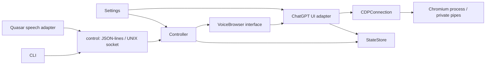

# Архитектура

## Управление диалогом



| Модуль | Ответственность |
| --- | --- |
| `cli.py` | Аргументы, вывод и коды завершения |
| `config.py` | Неизменяемый `Settings`, чтение и проверка окружения при запуске |
| `control.py` | Ограниченные JSON-lines сообщения, progress/final, сервер и общий клиент |
| `controller.py` | Состояния ожидания/загрузки/Voice/Chat/Work, отмена длительных операций |
| `browser.py` | Вкладка ChatGPT, разрешение микрофона, команды интерфейса и диагностика |
| `browser_ui.py` | Поиск видимых голосовых кнопок; здесь меняются DOM-селекторы |
| `navigation.py` | Переключатели Chat/Work, выбор проекта, сохранение контекста |
| `webrtc_diagnostics.py` | Выборочный экспорт счётчиков из локального webrtc-internals |
| `browser_launch.py` | Политика headless/visible, расширений и памяти |
| `indicators.py` | Временное управление RGB-логотипом Midi и восстановление штатных LED-триггеров |
| `cdp.py` | Владение процессом/дескрипторами, CDP request IDs, тайм-ауты и ошибки транспорта |
| `cdp_spawn.py`, `alpine_exec.py` | FD 3/4, chroot и переход к UID/GID 1000 |
| `state.py` | Проверенные conversation URL и атомарная запись приватного JSON |
| `browser_diagnostics.py`, `maintenance.py` | Снимки/структурная диагностика, ручной вход и проверки хоста |
| `quasar_ipc.py`, `commands.py` | Декодирование событий прошивки, точное распознавание и дедупликация команд |

Контроллер работает через `VoiceBrowser`: ему не нужны `Popen`, PID, CDP или
Chromium flags. Для другого браузерного адаптера достаточно реализовать
этот интерфейс и передать экземпляр в `Controller(browser=...)`.
`StateStore`, часы и ожидание также можно подставить при тестировании.

`open`/`new` сериализуются. `close` отменяет активную загрузку, а `status`,
`diagnose`, `snapshot`, `vpn-check` доступны без ожидания её завершения.
CDP допускает параллельные запросы и сопоставляет ответы по ID. Запись в pipe
не блокирует event loop; частичные записи обрабатываются под общей блокировкой.
EOF завершает ожидающие запросы и немедленно отклоняет последующие.

Режим `voice` устанавливается после обнаружения кнопки завершения разговора;
одного клика недостаточно. `voice_ui_ready: true` подтверждает интерфейс,
а `verified: false` напоминает, что WebRTC и слышимый ответ этим не проверены.
Служебные экраны login/лимита и onboarding обрабатываются отдельно; ручная
проверка браузера не нажимается автоматически. `controller_lease()` предотвращает
одновременный запуск двух контроллеров до работы с UNIX socket.
При ручной проверке состояние `verification` сохраняет окно открытым после
таймаута команды. После проверки повторный `open` использует ту же вкладку;
`close` завершает браузер в любом состоянии.

Quasar обрабатывает завершённые команды в ограниченных фоновых задачах, поэтому
долгое открытие не блокирует чтение команды закрытия. При разрыве IPC эти задачи
отменяются до закрытия соединения.

## Аудио

```text
ALSA hw:0,1: 4 × S16_LE / 96 кГц
  → arecord с отдельным ALSA config
  → нативный SoX в Alpine: выбранный канал, gain, 16 кГц / моно
  → PulseAudio pipe source midi_microphone → Chromium

Chromium → PulseAudio pipe sink midi_speaker
  → FIFO: 48 кГц / S16_LE / stereo
  → native SoX: 96 кГц / 4 канала L,R,L,R → aplay ALSA default
```

`audio_format.py` задаёт аппаратный контракт; `pulse.py` — общие имена устройств,
пути, конфигурацию и жизненный цикл FIFO. `pulse_mic.py` и `pulse_speaker.py`
занимаются соответствующими потоками. `processes.py` управляет завершением
их дочерних процессов и временными обработчиками сигналов.

PDM остаётся на **96 кГц**: его частота общая с трактом прошивки. Это ограничение
описано в [документации устройства](https://hackalice.me/devices/station-midi/).
PulseAudio создаёт FIFO сам. Существующий сервер проверяется до очистки старых
FIFO. Микрофон сбрасывает блок при переполнении; воспроизведение сохраняет
границы стереосэмплов и допускает остановку при медленном ALSA-потребителе.

`audio_probe.py`, `audio_stream.py`, `mic_server.py`, `speaker.py` предоставляют
явные диагностические команды. Python FIR используется для диагностики и
локального `mic-serve`; рабочий браузерный аудиомост использует нативный SoX.

## Сессии на станции

`scripts/lib/session.sh` задаёт окружение, запускает, наблюдает и завершает
собственные процессы. `display.sh` запускает Xvfb/VNC и ручной Chromium нативно
через Alpine BusyBox `su`. `audio.sh` содержит единственную реализацию запуска
PulseAudio и обоих аудиомостов.

`run-voice.sh` и `login-browser.sh` собирают эти части в сессии. Четыре прежних
скрипта запуска остались небольшими оболочками. Ручной вход без аудио не требует
host Python. Обычный visible voice не запускает VNC; debug VNC и login VNC
слушают localhost. SIGTERM контроллера запускает очистку браузера.

`prepare-alpine-runtime.sh` восстанавливает proc, read-only sysfs и приватный
tmpfs `/dev/shm`, потерянные после перезагрузки станции. Эту подготовку нельзя
заменять одной установкой пакетов: отсутствие proc приводило к SIGTRAP Chromium.

Изменения DOM вносятся в `browser_ui.py`, политика запуска — в
`browser_launch.py`, другая прошивка/источник команд — в отдельный адаптер рядом
с `quasar_ipc.py`. Для новой настройки добавляются поле `Settings`, чтение
окружения, проверка и описание в README.
